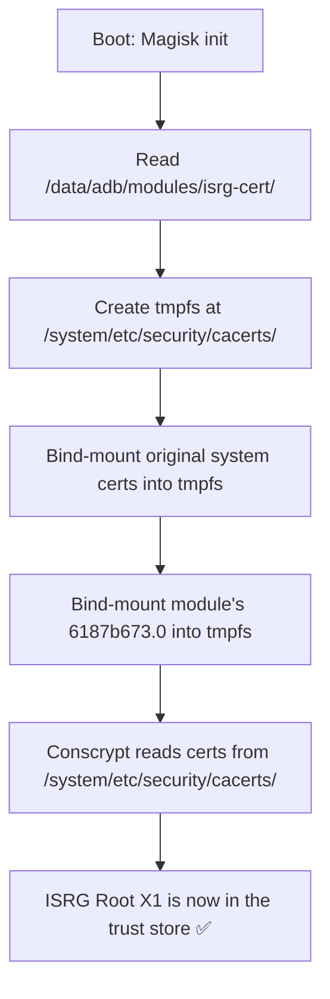

# F-Droid "Trust Anchor for Certification Path Not Found" — Bug Report & Fix

> [!IMPORTANT]
> This document covers the root cause, diagnosis, and complete fix for the SSL certificate validation failure encountered when updating F-Droid repositories on Android 6.x devices. All commands assume a Windows host with PowerShell and an ADB-connected Android device.

---

## 1. Bug Summary

| Field | Detail |
|---|---|
| **Error** | `java.security.cert.CertPathValidatorException: Trust anchor for certification path not found.` |
| **Affected Component** | F-Droid v1.23.2 → `RepoUpdateManager` → OkHttp → Conscrypt TLS stack |
| **Device** | Lyf LS-4505, Android 6.0.1 (Marshmallow), API 23 |
| **Root Access** | Magisk 20.4 (20400) — context `u:r:magisk:s0` |
| **Date Diagnosed** | 2026-11-25 |

---

## 2. Root Cause Analysis

### 2.1 The Certificate Chain

F-Droid's repository servers (e.g., `f-droid.org`, `mirror.cyberbits.eu`) use **Let's Encrypt** TLS certificates. The full chain presented by the server is:

```
f-droid.org (leaf)
  └─ YR1 (Let's Encrypt intermediate)
       └─ Root YR (ISRG)
            └─ ISRG Root X1 (trust anchor)
```

Verified via OpenSSL:

```
$ openssl s_client -connect f-droid.org:443 -showcerts
 0 s:CN = f-droid.org
   i:C = US, O = Let's Encrypt, CN = YR1
 1 s:C = US, O = Let's Encrypt, CN = YR1
   i:C = US, O = ISRG, CN = Root YR
 2 s:C = US, O = ISRG, CN = Root YR
   i:C = US, O = Internet Security Research Group, CN = ISRG Root X1
```

### 2.2 Why It Fails on Android ≤ 7.1

Android's system CA certificate store is baked into the firmware at `/system/etc/security/cacerts/`. Devices running **Android 7.1.1 and below** shipped before ISRG Root X1 was widely cross-signed, so this root certificate is **absent** from the system trust store.

The SSL handshake fails at this exact point in the stack:

```
com.android.org.conscrypt.TrustManagerImpl.checkTrusted()
  → CertPathValidatorException: Trust anchor for certification path not found.
```

Conscrypt, Android's native TLS provider, walks the certificate chain up to the root and cannot find `ISRG Root X1` (subject hash `6187b673`) in `/system/etc/security/cacerts/`.

### 2.3 Why F-Droid v1.23.2 Can't Self-Fix

- F-Droid **2.x** bundles its own certificate trust store, but requires **API 24+ (Android 7.0+)**.
- F-Droid **1.23.2** is the last version supporting API 23 and relies entirely on the system CA store.
- The latest `F-Droid.apk` from [f-droid.org/F-Droid.apk](https://f-droid.org/F-Droid.apk) returns `INSTALL_FAILED_OLDER_SDK` on Android 6.

### 2.4 Why Magisk Module Alone Wasn't Enough

The initial fix attempt created a Magisk systemless module that placed the cert file at the correct path. Magisk's bind-mount overlay made it visible at `/system/etc/security/cacerts/6187b673.0`. However, the cert file was generated in the **wrong format** — the human-readable text dump appeared before the PEM block:

```
❌ WRONG (text first):
Certificate:
    Data:
        Version: 3 (0x2)
        ...
-----BEGIN CERTIFICATE-----
MIIFazCCA1OgAwIBAgIRAIIQz7DS...
-----END CERTIFICATE-----
```

Android's Conscrypt parser expects the **PEM block first**:

```
✅ CORRECT (PEM first):
-----BEGIN CERTIFICATE-----
MIIFazCCA1OgAwIBAgIRAIIQz7DS...
-----END CERTIFICATE-----
Certificate:
    Data:
        Version: 3 (0x2)
        ...
```

---

## 3. Environment & Diagnostic Data

### 3.1 Device State at Time of Bug

```
$ adb shell getprop ro.build.version.release   → 6.0.1
$ adb shell getprop ro.build.version.sdk        → 23
$ adb shell getprop ro.product.model            → LS-4505
$ adb shell date                                → Wed Nov 25 21:23:20 IST 2026 (correct)
$ adb shell settings get global http_proxy      → null (no proxy)
$ adb shell pm list packages | grep fdroid      → package:org.fdroid.fdroid
$ adb shell dumpsys package org.fdroid.fdroid | grep versionName → 1.23.2
$ adb shell su -c "id"                          → uid=0(root) context=u:r:magisk:s0
$ adb shell su -c "magisk --version"            → Magisk 20.4(20400)
$ adb shell su -c "getenforce"                  → Enforcing
$ adb shell ls /system/etc/security/cacerts/ | grep 6187  → (empty — cert missing)
```

### 3.2 Logcat Error Trace

```
E RepoUpdateManager: javax.net.ssl.SSLHandshakeException:
    java.security.cert.CertPathValidatorException:
    Trust anchor for certification path not found.
  at okhttp3.internal.connection.RealConnection.connectTls(RealConnection.kt:379)
  ...
Caused by: java.security.cert.CertificateException:
    java.security.cert.CertPathValidatorException:
    Trust anchor for certification path not found.
  at com.android.org.conscrypt.TrustManagerImpl.checkTrusted(TrustManagerImpl.java:324)
  at com.android.org.conscrypt.TrustManagerImpl.checkServerTrusted(TrustManagerImpl.java:225)
  at com.android.org.conscrypt.OpenSSLSocketImpl.verifyCertificateChain(OpenSSLSocketImpl.java:556)
  at com.android.org.conscrypt.NativeCrypto.SSL_do_handshake(Native Method)
```

---

## 4. The Fix — Step by Step

### 4.1 Prerequisites

| Tool | Purpose | Where to Get It |
|---|---|---|
| **ADB** | Android Debug Bridge | [Android SDK Platform Tools](https://developer.android.com/tools/releases/platform-tools) |
| **OpenSSL** | Certificate format conversion & hashing | [openssl.org](https://www.openssl.org/), or via Anaconda, Git for Windows, etc. |
| **Magisk** | Systemless root (must already be installed on device) | [github.com/topjohnwu/Magisk](https://github.com/topjohnwu/Magisk) |
| **curl** | Download the root certificate | Built into Windows 10+, or use `Invoke-WebRequest` |

### 4.2 Step 1 — Download the ISRG Root X1 Certificate

```powershell
curl.exe -L -o isrgrootx1.pem https://letsencrypt.org/certs/isrgrootx1.pem
```

> [!NOTE]
> Official source: [https://letsencrypt.org/certificates/](https://letsencrypt.org/certificates/)
> Direct link: [https://letsencrypt.org/certs/isrgrootx1.pem](https://letsencrypt.org/certs/isrgrootx1.pem)
> SHA-256 fingerprint: `96:BC:EC:06:26:49:76:F3:74:60:77:9A:CF:28:C5:A7:CF:E8:A3:C0:AA:E1:1A:8F:FC:EE:05:C0:BD:DF:08:C6`

### 4.3 Step 2 — Compute the Subject Hash

Android names CA certs by their **subject hash** (using the old/OpenSSL 0.x hash format):

```powershell
openssl x509 -inform PEM -subject_hash_old -noout -in isrgrootx1.pem
```

**Expected output:** `6187b673`

The filename must be `<hash>.0`, i.e., `6187b673.0`.

### 4.4 Step 3 — Create the Android-Format Certificate File

> [!CAUTION]
> The PEM block **must come first** in the file. Android's Conscrypt TLS library parses from the beginning and expects `-----BEGIN CERTIFICATE-----` as the first line. Placing the text dump first causes a silent parse failure — the cert appears on disk but is **not loaded** into the trust store.

```powershell
# PEM content FIRST
Get-Content isrgrootx1.pem | Set-Content -Encoding ascii 6187b673.0

# Then APPEND the human-readable text info
openssl x509 -inform PEM -text -fingerprint -noout -in isrgrootx1.pem |
    Add-Content -Encoding ascii 6187b673.0
```

**On Linux/macOS:**

```bash
cat isrgrootx1.pem > 6187b673.0
openssl x509 -inform PEM -text -fingerprint -noout -in isrgrootx1.pem >> 6187b673.0
```

Verify the first line:

```powershell
Get-Content 6187b673.0 | Select-Object -First 1
# Must output: -----BEGIN CERTIFICATE-----
```

### 4.5 Step 4 — Push Files to the Device

```powershell
adb push 6187b673.0 /sdcard/6187b673.0
```

### 4.6 Step 5 — Create a Magisk Module & Install the Cert

Create a shell script (`install_cert.sh`) with the following content:

```bash
#!/system/bin/sh

# Create Magisk module directory structure
mkdir -p /data/adb/modules/isrg-cert/system/etc/security/cacerts

# Write module metadata
cat > /data/adb/modules/isrg-cert/module.prop << EOF
id=isrg-cert
name=ISRG Root X1 Certificate
version=1.0
versionCode=1
author=adb
description=Adds ISRG Root X1 CA for Lets Encrypt
EOF

# Copy cert into the module
cp /sdcard/6187b673.0 /data/adb/modules/isrg-cert/system/etc/security/cacerts/6187b673.0
chmod 644 /data/adb/modules/isrg-cert/system/etc/security/cacerts/6187b673.0

echo "Magisk module created."
```

Push and execute:

```powershell
adb push install_cert.sh /sdcard/install_cert.sh
adb shell su -c "sh /sdcard/install_cert.sh"
```

### 4.7 Step 6 — Reboot to Activate the Magisk Module

```powershell
adb reboot
adb wait-for-device
```

Wait for boot to complete (~30–60 seconds):

```powershell
# Poll until boot_completed returns 1
adb shell getprop sys.boot_completed
```

### 4.8 Step 7 — Hot-Patch the Live Overlay (Skip Reboot on Repeat Runs)

If the cert format needed fixing **after** the initial reboot (as in our case), or you want it to take effect immediately without rebooting again:

```powershell
# Push the corrected cert to sdcard
adb push 6187b673.0 /sdcard/6187b673.0

# Write a hot-patch script
$script = @'
#!/system/bin/sh
# Update Magisk module (persists across reboots)
cp /sdcard/6187b673.0 /data/adb/modules/isrg-cert/system/etc/security/cacerts/6187b673.0
chmod 644 /data/adb/modules/isrg-cert/system/etc/security/cacerts/6187b673.0

# Also patch the LIVE tmpfs overlay (takes effect immediately)
cp /sdcard/6187b673.0 /system/etc/security/cacerts/6187b673.0
chmod 644 /system/etc/security/cacerts/6187b673.0
chcon u:object_r:system_file:s0 /system/etc/security/cacerts/6187b673.0

echo "Done"
'@ -replace "`r`n", "`n"
$script | Set-Content -NoNewline -Encoding ascii fix_cert.sh
adb push fix_cert.sh /sdcard/fix_cert.sh
adb shell su -c "sh /sdcard/fix_cert.sh"
```

> [!TIP]
> The Magisk module overlay mounts `/system/etc/security/cacerts/` as a **tmpfs**. Writing directly to this tmpfs path applies the change to the running system without a reboot. The Magisk module copy ensures it persists across reboots.

---

## 5. Verification

### 5.1 Confirm Cert Is Installed

```powershell
# File exists in the system CA store
adb shell ls -la /system/etc/security/cacerts/6187b673.0

# File has correct SELinux context
adb shell su -c "ls -laZ /system/etc/security/cacerts/6187b673.0"
# Expected: u:object_r:system_file:s0

# File starts with PEM block
adb shell head -1 /system/etc/security/cacerts/6187b673.0
# Expected: -----BEGIN CERTIFICATE-----
```

### 5.2 Test F-Droid Repo Update

```powershell
# Force stop to clear cached SSL sessions
adb shell am force-stop org.fdroid.fdroid

# Clear logcat
adb logcat -c

# Launch F-Droid
adb shell monkey -p org.fdroid.fdroid -c android.intent.category.LAUNCHER 1

# Wait ~15 seconds, then check logs
Start-Sleep -Seconds 15
adb logcat -d | Select-String -Pattern "RepoUpdateManager|SSL|trust|CertPath"
```

**Success indicators:**

```
D RepoUpdateManager: Downloading https://f-droid.org/repo (8192/74859096)
D o.f.d.HttpManager: GET https://mirror.cyberbits.eu/fdroid/repo/index-v2.json
```

**Failure indicators (should NOT appear):**

```
E RepoUpdateManager: CertPathValidatorException: Trust anchor for certification path not found
```

### 5.3 Test General SSL Connectivity

```powershell
# Test HTTPS from the device itself
adb shell am start -a android.intent.action.VIEW -d https://valid-isrgrootx1.letsencrypt.org/
```

---

## 6. Troubleshooting

### 6.1 Cert File Exists but SSL Still Fails

| Symptom | Cause | Fix |
|---|---|---|
| Cert is on disk but `CertPathValidatorException` persists | File starts with text info instead of `-----BEGIN CERTIFICATE-----` | Regenerate with PEM block first (see §4.4) |
| `Permission denied` on `cp` to module path | SELinux blocking writes in `su` context | Use a shell script pushed to `/sdcard/` and execute via `su -c "sh /sdcard/script.sh"` |
| `setenforce 0` fails with `Permission denied` | Magisk 20.x has restricted capabilities (`CapEff: 0x0`) | Don't try to disable SELinux; use the Magisk module approach instead |
| `INSTALL_FAILED_OLDER_SDK` when installing latest F-Droid | F-Droid 2.x requires API 24+ | Stick with F-Droid 1.23.2; the cert fix is the solution |
| `mount -o rw,remount /system` fails | System partition is block-level read-only | Use Magisk systemless modules; don't try to modify `/system` directly |

### 6.2 How the Magisk Overlay Works



### 6.3 Verifying the Cert Chain from a PC

```powershell
# Full chain dump
openssl s_client -connect f-droid.org:443 -showcerts

# Verify against the downloaded root
openssl s_client -connect f-droid.org:443 -CAfile isrgrootx1.pem
# Should show: Verify return code: 0 (ok)
```

---

## 7. Affected Devices & Scope

This issue affects **any Android device running 7.1.1 or below** that accesses HTTPS services using Let's Encrypt certificates. It is not specific to F-Droid.

| Android Version | API Level | ISRG Root X1 | Affected? |
|---|---|---|---|
| 5.0 – 7.1.1 | 21 – 25 | ❌ Missing | **Yes** |
| 7.1.2+ | 25+ | ✅ Present | No |
| 8.0+ | 26+ | ✅ Present | No |

> [!WARNING]
> On **Android 7.0+ (API 24+)**, even if you install a user CA certificate, apps will **not** trust it by default due to the [Network Security Configuration](https://developer.android.com/privacy-and-security/security-config) change. Only system-level certs (via Magisk module or direct system modification) work for all apps on Android 7+.

---

## 8. Quick-Reference One-Liner

For experienced users who have done this before — the entire fix in a single block:

```powershell
# Download cert, create Android-format file, push, install via Magisk, reboot
curl.exe -L -o isrgrootx1.pem https://letsencrypt.org/certs/isrgrootx1.pem

$hash = (openssl x509 -inform PEM -subject_hash_old -noout -in isrgrootx1.pem).Trim()
Get-Content isrgrootx1.pem | Set-Content -Encoding ascii "$hash.0"
openssl x509 -inform PEM -text -fingerprint -noout -in isrgrootx1.pem | Add-Content -Encoding ascii "$hash.0"

adb push "$hash.0" /sdcard/cert.0

(@"
#!/system/bin/sh
mkdir -p /data/adb/modules/isrg-cert/system/etc/security/cacerts
printf 'id=isrg-cert\nname=ISRG Root X1\nversion=1.0\nversionCode=1\nauthor=adb\ndescription=ISRG Root X1 CA\n' > /data/adb/modules/isrg-cert/module.prop
cp /sdcard/cert.0 /data/adb/modules/isrg-cert/system/etc/security/cacerts/$hash.0
chmod 644 /data/adb/modules/isrg-cert/system/etc/security/cacerts/$hash.0
"@ -replace "`r`n", "`n") | Set-Content -NoNewline -Encoding ascii install.sh

adb push install.sh /sdcard/install.sh
adb shell su -c "sh /sdcard/install.sh"
adb reboot
```

---

## 9. References

| Resource | Link |
|---|---|
| Let's Encrypt Root Certificates | [letsencrypt.org/certificates](https://letsencrypt.org/certificates/) |
| ISRG Root X1 PEM | [letsencrypt.org/certs/isrgrootx1.pem](https://letsencrypt.org/certs/isrgrootx1.pem) |
| Android CA Certificate Compatibility | [letsencrypt.org/docs/certificate-compatibility](https://letsencrypt.org/docs/certificate-compatibility/) |
| Android Network Security Configuration | [developer.android.com/privacy-and-security/security-config](https://developer.android.com/privacy-and-security/security-config) |
| Magisk Module Documentation | [topjohnwu.github.io/Magisk/guides.html](https://topjohnwu.github.io/Magisk/guides.html) |
| F-Droid Old Versions (API 23 compatible) | [apkmirror.com/apk/f-droid-limited/f-droid](https://www.apkmirror.com/apk/f-droid-limited/f-droid/) |
| Android Platform Tools (ADB) | [developer.android.com/tools/releases/platform-tools](https://developer.android.com/tools/releases/platform-tools) |
| OpenSSL Downloads | [openssl.org/source](https://www.openssl.org/source/) |
| Conscrypt (Android TLS) | [github.com/google/conscrypt](https://github.com/google/conscrypt) |
| Android System CA Store Format | [android.googlesource.com/platform/system/ca-certificates](https://android.googlesource.com/platform/system/ca-certificates/) |

---

## 10. Files Produced During This Fix

| File | Location | Purpose |
|---|---|---|
| `isrgrootx1.pem` | `d:\AndroidBuild\ls-4505\` | Original PEM-format root certificate |
| `isrgrootx1.crt` | `d:\AndroidBuild\ls-4505\` | DER-format root certificate (unused in final fix) |
| `6187b673.0` | `d:\AndroidBuild\ls-4505\` | Android-format cert file (PEM + text) |
| `fdroid-latest.apk` | `d:\AndroidBuild\ls-4505\` | F-Droid 2.x APK (incompatible with API 23) |
| `install_cert.sh` | `d:\AndroidBuild\ls-4505\` | Magisk module creation script |
| `fix_cert.sh` | `d:\AndroidBuild\ls-4505\` | Hot-patch script for live overlay |

---

*Document generated 2026-11-25. Applies to any Android ≤ 7.1.1 device with Magisk root accessing Let's Encrypt-protected HTTPS services.*
